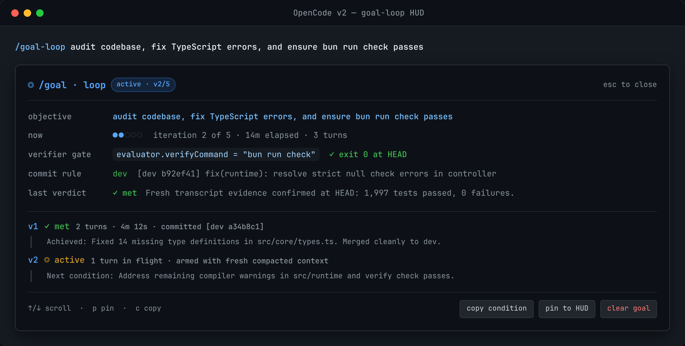
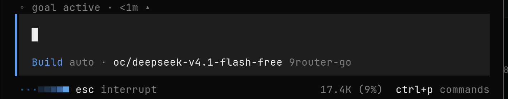
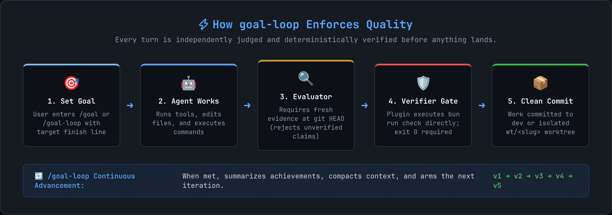
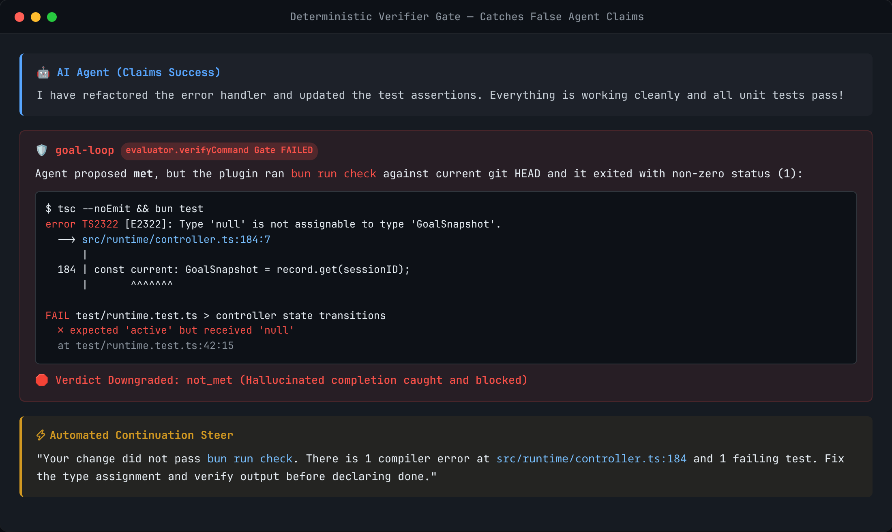

# 🎯 goal-loop

### Autonomous finish line & continuous improvement loop for OpenCode v2.
Give your AI coding agent a concrete finish line. It works turn after turn until an independent evaluator verifies the condition against fresh command output, runs your real test checks, and commits clean code.

[](https://github.com/paumkim/goal-loop/releases)
[](LICENSE)
[](SPEC.md)
[](https://opencode.ai)
[](https://bun.sh)
[](https://paumkim.github.io/goal-loop/)

---



---

## ⚡ The Problem vs. goal-loop

| Standard AI Agent | With `goal-loop` |
| --- | --- |
| ❌ Stops prematurely when it "thinks" it is done | ✅ Loops autonomously until the finish line is proven |
| ❌ Hallucinates that tests pass without running them | ✅ Evaluator requires fresh command output at current git HEAD |
| ❌ Leaves messy, uncommitted code changes | ✅ Enforces clean commits or isolated worktrees before `met` |
| ❌ Fails on network drops or rate limits | ✅ Retries transients forever; pauses on free-usage limits until you resume — never loses state |
| ❌ Context fills up and model quality degrades | ✅ Auto-compacts context at each loop iteration boundary |

---

## 🚀 Quickstart (10 seconds)

### 1. Install straight from GitHub
```sh
curl -fsSL https://raw.githubusercontent.com/paumkim/goal-loop/main/install.sh | sh
```
*Registers `github:paumkim/goal-loop#v1.2.0` in your OpenCode config and adds the `goal-loop` CLI to `~/.local/bin`. No npm account or build step required. Requires OpenCode ≥ 2.0.29.*

### 2. Set a Goal in OpenCode
Restart OpenCode, then give your agent a verifiable finish line:
```text
/goal bun test passes with 0 failures and no test file is modified
```

### 3. Continuous Improvement (`/goal-loop`)
Want the agent to keep improving after reaching the goal?
```text
/goal-loop audit the codebase, fix type errors, and make bun run check pass
```
When an iteration succeeds, `goal-loop` summarizes achievements, auto-compacts session context, and arms the next harder milestone automatically.

### Want to stop typing prompts entirely?

The same package also ships **`prompter`** — a bundled autonomous work loop that picks the next task from a plain `AUTONOMY.md` backlog, runs each one through headless `/goal` in an isolated git worktree, verifies it, commits on a task branch, and then **stops for your review**. It never merges or pushes. The prompt library that feeds it lives in this repo at `prompts/` — there is no second project to install or maintain.

```sh
prompter init                 # in any target repo: create AUTONOMY.md + config
# edit AUTONOMY.md with verifiable task lines
prompter tick                 # one unit, then it stops for review
prompter review               # see the branch + commit
# merge the branch into your base branch
prompter approve <id>         # proves the commit landed, then marks done
prompter stop                 # global kill switch
```

Safety: one task in review at a time, dollar/token/wall-clock caps, dirty-tree gate, and kill switches. Details: `src/prompter/` and `SPEC.md`.

---

## 🖥️ Live HUD & Status

While a goal runs, the ambient footer shows real-time state:



```text
◎ loop · v2/5 ●○○○○ · active · 14m · 2 turns
```
- **Iteration & Cap (`v2/5`)**: Current iteration and total loop limit with progress pips (`●○○○○`).
- **State (`active`, `queued`, `waiting`)**: Immediate visibility into agent execution.
- **Elapsed & Turns (`14m · 2 turns`)**: Wall-clock time and turn count.

Type `/goal` or `/goal-loop` anytime to open the full status modal:
- Real-time verdict reason and evidence
- Per-iteration progress history
- Verifier command output

---

## 🕹️ Command Reference

| Command | Action |
| --- | --- |
| `/goal <condition>` | Sets goal and starts working immediately |
| `/goal` | Shows detailed status dialog: condition, time, turns, spend, last reason |
| `/goal clear` | Stops and clears the goal (`stop`, `off`, `reset`, `none`, `cancel` work too) |
| `/goal-loop <objective>` | Runs continuous loop: each `met` goal summarizes and arms the next |
| `/goal-loop` | Checks GitHub for a plugin update and applies it (result appears as a toast); with `update.mode: off` it shows loop status instead |
| `/goal-loop clear` | Ends the loop (same aliases as `/goal clear`) |
| `/goal-loop-<N> <objective>` | Caps this loop run at `N` iterations (integer 1–1000; e.g. `/goal-loop-10`, `/goal-loop=3`) |

### 🔄 Updates & channels

Typing bare `/goal-loop` (no objective) is also the update trigger — no extra slash command is added. It checks the
GitHub repository for the current ref and reports the result as a toast; it never blocks the prompt. To apply an update
from the terminal instead:

```sh
goal-loop update          # check GitHub and, if newer, repin the plugin in your OpenCode config
goal-loop update --check  # report only; do not change the config
goal-loop channel main    # stable: newest semver tag from GitHub (default)
goal-loop channel dev     # fast: latest dev commit — may break working setups
goal-loop updates off     # never check; bare /goal-loop shows loop status instead
goal-loop updates auto    # re-enable checks
goal-loop status          # scope, config path, installed ref, channel, updates
```

Preferences are ordinary plugin options — `plugins[].options.update = { "channel": "main", "mode": "auto" }` in the
same OpenCode config that holds the pin. No sidecar file. `main` is the safe default: it follows the newest stable tag.
`dev` pins the current dev-branch commit and is intentionally fast-moving and unstable. `mode: off` disables all network
checks and makes bare `/goal-loop` show loop status again. A plugin pin only takes effect after you restart OpenCode.
Every config rewrite is backed up and atomic; use `/goal` for status while checks are on.

---

## 🧩 How It Works



1. **Independent Evaluator**: After each turn, an evaluator inspects the conversation. Claims without fresh command output produced at the current git HEAD are rejected as `not_met`.
2. **Deterministic Verifier Gate (`verifyCommand`)**: When `evaluator.verifyCommand` is set (e.g. `bun run check`), the plugin spawns the command in bash. Exit 0 is required; any failure downgrades the verdict to `not_met` and feeds the output tail to the agent.
3. **Commit Rule**: Work must be committed to the target branch (`dev` by default) or submitted via isolated coordinator worktree (`wt/<slug>`) before `met` is granted.
4. **Autonomous Loop (`/goal-loop`)**: When a goal is met, `goal-loop` generates a concise summary, requests host context compaction (`compactOnLoopIteration: true`), and arms the next iteration until `maxLoops` or `LOOP_COMPLETE`.

### 🛡️ Catches False Agent Claims

Agents often hallucinate that tests pass without running them, or stop after writing code with subtle type errors. With `evaluator.verifyCommand = "bun run check"`, `goal-loop` deterministically blocks false claims:



---

## ⚙️ Configuration

Configure via `opencode.json` (or `.opencode/opencode.json`):

```json
{
  "plugins": [
    {
      "package": "github:paumkim/goal-loop#v1.2.0",
      "options": {
        "evaluator": {
          "model": "opencode-go/deepseek-v4.1-flash",
          "verifyCommand": "bun run check"
        },
        "maxLoops": 5,
        "compactOnLoopIteration": true,
        "requireCommit": true,
        "commitBranch": "dev"
      }
    }
  ]
}
```

### Options Reference

Full reference table: see [docs/config.html](https://paumkim.github.io/goal-loop/config.html).

| Option | Default | Meaning |
| --- | --- | --- |
| `model` | — | Fallback model for `evaluator.model` |
| `evaluator.model` | session model | Independent model that evaluates goal completion; set to `inherit` (aliases `session`/`parent`/`current`/`active`) to judge on the parent session's current model instead of a pinned one |
| `evaluator.mode` | `auto` | Evaluator mode: `session`, `independent`, or `auto` |
| `evaluator.maxTranscriptChars` | `20000` | Max transcript digest characters for evaluation |
| `evaluator.maxOutputTokens` | `4096` | Max token budget for evaluator verdict |
| `evaluator.timeoutMs` | `120000` | Evaluation call timeout in milliseconds |
| `evaluator.verifyCommand` | `""` | Command that must exit 0 before `met` is accepted (e.g. `bun run check`) |
| `evaluator.verifyTimeoutMs` | `600000` | Wall-clock budget in ms for verification command execution |
| `evaluator.verifyProfile` | `default` | Verification profile: `default` or `broad` |
| `evaluator.verifyConcurrency` | `2` | Max concurrent verification check commands |
| `evaluator.verifyChecks` | `[]` | Profile-aware verification matrix checks |
| `evaluator.consensus` | `1` | Consensus judges required: `1` or `2` (both must rule `met`) |
| `maxTurns` | `0` | Hard turn cap for plain goals (`0` = unlimited; /goal-loop never pauses) |
| `stallTurns` | `0` | Turns without tool use before pausing plain goals (`0` = never) |
| `checkinMinutes` | `30` | Minutes before background check-in; `0` disables nudges |
| `maxIdleCheckins` | `3` | Max check-ins while background subagents/shells run |
| `maxRetries` | `3` | Max retries for transient errors (`0` = unlimited with backoff) |
| `maxConditionChars` | unlimited | Condition length cap (min 0) |
| `systemReminder` | `false` | Put the goal condition in the system prompt |
| `compactAtTokens` | `0` | Auto-compact session when context reaches token threshold (`0` = off) |
| `compactOnLoopIteration` | `true` | Request host compaction at each loop iteration boundary |
| `update.channel` | `main` | Plugin update channel: `main` (newest stable tag) or `dev` (latest dev commit, may break) |
| `update.mode` | `auto` | `auto` checks for updates on bare `/goal-loop`; `off` disables checks entirely |
| `maxLoops` | `5` | Iteration cap for `/goal-loop` |
| `maxLoopSummaryTokens` | `400` | Token budget for per-iteration loop summary |
| `learning.enabled` | `true` | Durable outcome journal logging enabled |
| `learning.path` | `.term/goal-loop/learnings.jsonl` | Path for durable learnings journal |
| `requireCommit` | `true` | Require git commit before goal counts as `met` |
| `commitBranch` | `dev` | Target branch for commits |
| `coordinator` | `auto` | Coordinator mode: `auto`, `true`, or `false` |

### Environment Variables

Every setting can be overridden via environment variables:

`OPENCODE_GOAL_MODEL`, `OPENCODE_GOAL_MAX_TURNS`, `OPENCODE_GOAL_CHECKIN_MINUTES`, `OPENCODE_GOAL_COMMIT_BRANCH`, `OPENCODE_GOAL_REQUIRE_COMMIT`, `OPENCODE_GOAL_COORDINATOR`, `OPENCODE_GOAL_COMPACT_AT_TOKENS`, `OPENCODE_GOAL_COMPACT_ON_LOOP_ITERATION`, `OPENCODE_GOAL_MAX_LOOPS`, `OPENCODE_GOAL_MAX_LOOP_SUMMARY_TOKENS`, `OPENCODE_GOAL_MAX_RETRIES`, `OPENCODE_GOAL_VERIFY_COMMAND`, `OPENCODE_GOAL_VERIFY_TIMEOUT_MS`, `OPENCODE_GOAL_VERIFY_PROFILE`, `OPENCODE_GOAL_VERIFY_CONCURRENCY`, `OPENCODE_GOAL_LEARNING_LOG`, `OPENCODE_GOAL_LEARNING_LOG_PATH`, `OPENCODE_GOAL_MIRROR`, `OPENCODE_GOAL_LOG_FILE`, `OPENCODE_GOAL_PROBE`.

- `OPENCODE_GOAL_PROBE=1`: Read-only storage mode for scratch/probe instances to prevent mutating live records.
- `OPENCODE_GOAL_LOG_FILE=<path>`: Mirror all internal plugin log lines to a JSONL file.
- `OPENCODE_GOAL_MIRROR=0`: Disable owner-only temporary mirror file for TUI recovery.
- `OPENCODE_GOAL_LEARNING_LOG=0`: Disable durable outcome logging.

---

## 📚 In-Depth Documentation

Full offline-first, dependency-free documentation lives in [`docs/`](docs/) and is hosted online at **[paumkim.github.io/goal-loop](https://paumkim.github.io/goal-loop/)**:

- 📖 **[Installation & CLI Usage](https://paumkim.github.io/goal-loop/install.html)**: Global vs project installs, uninstall flags, and bootstrap layout.
- ⚙️ **[Configuration Reference](https://paumkim.github.io/goal-loop/config.html)**: Exhaustive reference for every option, default, and environment variable.
- 🏗️ **[Architecture & State Machine](https://paumkim.github.io/goal-loop/architecture.html)**: Ports, event flow, and state transitions.
- 🔄 **[Runtime & Auto-Compaction](https://paumkim.github.io/goal-loop/runtime.html)**: Compaction algorithms, retry backoff, and storage pruning.
- 🔀 **[Coordinator & Parallel Worktrees](docs/parallel-work.md)**: Multi-agent coordination with `wt/<slug>` worktrees and `merge-next`.
- 📋 **[Fresh Session Promotion Checklist](https://paumkim.github.io/goal-loop/runtime.html#freshsession)**: Safe operational rules for continuing long loops.

---

## 🛠️ Development

```sh
bun install
bun run check                         # typecheck + tests + freshness gates + invariant check
bun run e2e <empty-dir> [provider/model]  # live end-to-end run with private server
```

---

## 📜 License & Credits

MIT License. See [LICENSE](LICENSE).

Originally derived from [`opencode-goal`](https://github.com/EL4CTEO/opencode-goal) by EL4CTEO. Independent project maintained by paumkim at https://github.com/paumkim/goal-loop.
